# The Ground visualizer: design

Status: design spike (visualizer step 1, task d37adc267995, under decision 09f29f6c727b). This document
holds the JSON the views need (published first, so the server in step 2 can match it), the visual
language, and the mockups in [visualizer/](visualizer/). Nothing here is production code. The real Loom
(step 3, task 3efd86e31c2b) is `bracken view`'s page, in `crates/bracken/assets/view/`; section 3.1 says
where it differs from the mockup.

## 1. The JSON the views need

`bracken view` serves these read-only on 127.0.0.1. Every shape is built from library calls that already
exist (`topo_order`, `heads`, `Policy::assess`, `Policy::evaluate`, `referrers`, `open_conflicts`,
`live_intents`) and reuses the CLI's `--json` field names, so `bracken log --json` and the API read the
same. All ids are full 64-digit hex. Times are the authors' own `timestamp_ms`: advisory, never an
ordering (causal order is the order).

Text from contributions (statements, tags, names, notes, methods, details, agent names) is untrusted:
the page inserts it with `textContent` only. The server sends it as written; it never pre-escapes for
HTML, so nothing is double-escaped and nothing depends on the escaping being right.

### 1.1 `GET /api/ground`: what the page opens with

```json
{
  "ground": "<64 hex>",
  "name": "auth",
  "now_ms": 1761696000000,
  "contributions": 1234,
  "heads": ["<64 hex>", "..."],
  "cursor": "<hex>,<hex>",
  "policy": { "min_passes": 1, "validators": [] },
  "agents": [
    {
      "agent": "<64 hex public key>",
      "name": "alice",
      "contributions": 412,
      "first_ms": 1761600000000,
      "last_ms": 1761695000000
    }
  ]
}
```

- `cursor` is `log --since`'s cursor (sorted heads, comma-separated).
- `agents` lists every author in the Ground, in order of first contribution (causal order). `name` is
  the replica's local name, or `null` for an agent with no local entry; the page then shows `~<8 hex>`,
  as the CLI does.
- `policy` is the one the server assesses under (`--min-passes`, `--validator` on `bracken view`, the
  same flags as `accepted`). Every `status` below is under it.

### 1.2 `GET /api/graph?since=<cursor>`: the whole woven graph, compactly

The Loom needs every contribution's kind, author, parents and time at once, for 50,000 of them, and
none of their text. So this is columnar: one array per field, one entry per contribution, in causal
order (`topo_order` restricted to what's new since the cursor). Without `since`, it's everything.

```json
{
  "cursor": "<hex>,<hex>",
  "ids":     ["<64 hex>", "..."],
  "kind":    ["claim", "artifact", "relation", "evidence", "retract"],
  "author":  [0, 2, 1],
  "parents": [[], [0], [0, 1]],
  "time":    [1761600000000, 1761600004000, 1761600009000],
  "depth":   [0, 1, 2],
  "tags":    [["auth"], [], []],
  "refs":    ["<64 hex>"],
  "retracted": [5, 17],
  "failed":  [2],
  "retracts": [[4, 2]]
}
```

- `author` indexes `/api/ground`'s `agents`. An author new since the page loaded is appended there, so
  the page refetches `/api/ground` when an index is past its end.
- `parents[i]` holds integers. `n < ids.length` is a contribution in this response; `n >= ids.length` is
  `refs[n - ids.length]`, an id the page already has from an earlier response. Without `since`, `refs`
  is empty. (Positions can't be stable across responses: `topo_order` of a grown graph doesn't keep the
  old order as a prefix, so earlier contributions are named by id.)
- `depth[i]` is the longest causal path from a root to `i`: the Loom's fallback axis when times are
  absent or untrustworthy. It's one pass over `topo_order`.
- `tags[i]` is a claim's tags, `[]` for other kinds: tags drive the `intent` and `decision`-style marks
  without fetching text. Each tag is cut to 64 characters here.
- `retracted` lists the positions (in this response, or by id in `refs` terms as above) that a
  retraction, here or earlier, now targets. The page also learns of retractions from the `retract`
  contributions themselves; this list saves it resolving their targets.
- `failed` lists the positions of this response's evidence whose verdict is `fail` (added in step 3): the
  Loom draws passing and failing evidence differently, and the verdict is otherwise only in the text.
- `retracts` pairs each retraction in this response with its target's position, in the same terms
  (added in step 3). With it the page works out what's retracted itself, as `Graph::all_retracted`
  does, so a delta can take a retraction back (a retraction of a retraction) and the page still equals a
  fresh load, and it can say what was retracted at any cursor. `retracted` stays for other readers.
- Size: about 120 bytes a contribution, 5.9 MB for 50,000 (measured). That is the one big read; everything after it is
  incremental.

### 1.3 `GET /api/status`: where every subject stands now

Status changes as evidence and supersessions arrive, so it isn't part of the graph. One entry per subject
(claim or artifact) whose status isn't `pending` with no evidence, keyed by id:

```json
{
  "policy": { "min_passes": 1, "validators": [] },
  "statuses": {
    "<64 hex>": { "status": "accepted", "passes": 2, "fails": 0, "superseded_by": [] },
    "<64 hex>": { "status": "rejected", "passes": 1, "fails": 1, "superseded_by": [] }
  },
  "conflicts": [
    { "type": "contradiction", "relation": "<hex>", "a": "<hex>", "b": "<hex>" },
    { "type": "divergence", "target": "<hex>", "successors": ["<hex>", "<hex>"] }
  ]
}
```

`status` is `accepted`, `superseded`, `pending`, `rejected` or `retracted` (manyroot's `Status`), and
`conflicts` is `Evaluation::conflicts`, both as `accepted --json` already prints them. An id missing from
`statuses` is a pending subject with no counted evidence.

### 1.4 `GET /api/contribution/<id>`: one contribution, for the side panel

Exactly `bracken show <id> --json`: the contribution, `assessment`, `referrers` and `intents`, with one
change: an artifact's `text` is cut to 64 KiB, with `"text_truncated": true` when it was. `<id>` may be a
unique prefix of at least 8 digits; an unknown or ambiguous one is a 404 with
`{"error": "matches 2 contributions"}`, the CLI's message.

### 1.5 `GET /api/root/<id>`: one claim's life, for the Root view

```json
{
  "now_ms": 1761696000000,
  "claim": { "...": "a contribution, as in log --json", "assessment": { "status": "pending", "passes": [], "fails": [], "superseded_by": [] } },
  "lineage": {
    "replaces":    [{ "id": "<hex>", "statement": "...", "author_name": "alice", "timestamp_ms": 1761640000000, "status": "superseded" }],
    "replaced_by": [{ "id": "<hex>", "statement": "...", "author_name": "carol", "timestamp_ms": 1761670000000, "status": "pending", "counts": false }]
  },
  "implementations": [
    {
      "artifact": { "...": "a contribution; artifact body without text" },
      "relation": "<hex>",
      "relation_retracted": false,
      "assessment": { "status": "accepted", "passes": ["<hex>"], "fails": [], "superseded_by": [] },
      "evidence": [
        { "id": "<hex>", "verdict": "pass", "method": "cargo test", "author": "<hex>", "author_name": "val",
          "timestamp_ms": 1761690000000, "counted": true, "retracted": false }
      ]
    }
  ],
  "evidence": [ { "...": "evidence on the claim itself, same shape as above" } ],
  "intents": [
    { "id": "<hex>", "author": "<hex>", "author_name": "bob", "from_ms": 1761680000000,
      "until_ms": 1761683600000, "ended_ms": null, "ended_by": null }
  ],
  "refinements": [ { "id": "<hex>", "statement": "...", "author_name": "carol", "status": "pending" } ],
  "rivals": [
    { "id": "<hex>", "how": "contradicts", "relation": "<hex>", "statement": "...", "author_name": "dave",
      "status": "accepted" },
    { "id": "<hex>", "how": "divergent", "relation": "<hex>", "statement": "...", "author_name": "erin",
      "status": "pending" }
  ]
}
```

- `implementations` are artifacts that `implements` the claim, by any author, including retracted
  relations (`relation_retracted`), so the view can show a root that was cut.
- `evidence[].counted` is whether the policy counted it (it's in the assessment's `passes` or `fails`):
  evidence from a validator outside `--validator` still shows, dimmed.
- `intents` are every intent that refines the claim, live or not. `ended_by` is `implemented`,
  `retracted` or `expired` (or `null` while live); `ended_ms` is when (the implementing relation's or
  retraction's `timestamp_ms`, or `until_ms`). Intents without a valid `until:` tag aren't intents
  (README) and don't appear.
- `lineage.replaced_by[].counts` is whether that supersession counts (its relation's author wrote this
  claim); one that doesn't still shows, as a seedling that "doesn't count".
- `rivals`: claims that contradict this one (`how: contradicts`, either direction), and the other
  replacements of something this claim replaces when that's an open divergence (`how: divergent`).
- `statement` in these short entries is the first line, cut to 200 characters; the side panel fetches
  the full text from 1.4. Each short entry also carries its `timestamp_ms`, so the view can replay the
  claim's life without another request.
- An unknown or malformed cursor in `?as_of=` (or in `?since=` anywhere) is a 400 with
  `{"error": "..."}`, as is any parameter a page doesn't take: the server never ignores one.
- `?as_of=<cursor>` answers as the replica stood at that cursor: only contributions the cursor has seen,
  and every `assessment`, `status`, `counted` and intent end worked out over them. The Root view's replay
  scrubs through the cursors of the claim's own events. (The mockup approximates this from evidence
  times; the server shouldn't, since times are advisory and causal order is what holds.)

### 1.6 `GET /api/events`: the live feed (server-sent events)

```
event: contributions
data: {"graph": { "...": "as /api/graph?since=<the cursor the page last had>" }, "status_changed": {"<hex>": "accepted"}}

event: ping
data: {"now_ms": 1761696000000}
```

The server keeps one cursor per connection, sends `contributions` when its replica gains anything (it
watches by polling `heads` once a second; no file watcher), and `ping` every 15 s. `status_changed` lists
subjects whose status moved since the last event, so the page refetches `/api/status` only when it must.
On reconnect the page sends its cursor as `?since=` and gets what it missed in the first event.

### 1.7 What the API never carries

Tokens, `~/.bracken-team`, `.bracken/identities/` (private keys), local paths and anything outside the
replica. Every endpoint is a GET; there's no write path. Responses carry
`Content-Security-Policy: default-src 'none'; script-src 'self'; style-src 'self'; img-src 'self' data:;
connect-src 'self'; font-src 'self'; base-uri 'none'; form-action 'none'; frame-ancestors 'none'`, and the
server checks `Host` is `127.0.0.1:<port>` or `localhost:<port>` (against DNS rebinding).

By default it listens on 127.0.0.1 only. `--bind <ip>` names one other address instead. Owner decision
917816c72975 (2026-10-29) allows this machine's NetBird IP, so the owner can read the team Ground's view
from their own network. It narrows 09f29f6c727b's loopback-only rule for that one case.
- Bound that way, anyone who can reach the address can read the whole Ground: there's no login, and the
  server prints a warning saying so when it starts.
- It refuses to bind every interface (`0.0.0.0`, `::`), a multicast address or a broadcast address.
- It answers only to the Host `<ip>:<port>` (`[<ip>]:<port>` for IPv6) and to names given with
  `--host <name>`, as `<name>:<port>`. `localhost` counts only on a loopback address. Every other Host
  gets a 403.
- Everything else is unchanged: GET only, the same headers, no CORS, and the same bounds.

## 2. The direction: soil and specimen

The owner asked for organic and botanical (preference c60c03bca23d, 2026-10-28), with everything else the
builder's call. This section is the builder's reading of that brief, decisions 09f29f6c727b and
885847a45a8f, and task d37adc267995. PRODUCT.md at the repository root records the product facts behind
it, each inference marked. There was no design interview.

**The idea.** A Ground is a root system, and the visualizer is a window into the soil. Each agent is a
root growing down through time. Each contribution is a knot on its author's root, and the hyphae between
roots are the causal links that wove the work together. That's the mycorrhizal network ("many roots
sharing ground"), drawn truthfully:

- a link is there only because a contribution names its parents;
- a knot's place on the root is its author's;
- acceptance is a flower that opens only when the policy's passes arrive.

The thesis is a woven causal graph read like a living thing. It refuses a feed of cards, a git graph
and a dashboard of counts.

**Why this world and not another.** Every alternative the design process dealt was weighed against this
one, by who'd recognise it and how clearly it shows the product:

- a cutting bench;
- a quilt;
- a sticker album;
- formal gardens;
- a Googie diner;
- a hand-drawn zine.

Most of them lost on both counts. Three gave this world a discipline it adopted:

- **The cutting bench.** The replay scrubber settles on a contribution, never between two. A flag marks
  where the reader left off: the `log --since` cursor, made visible.
- **The quilt.** Every label is stitched to its knot by a visible hairline.
- **The sticker album.** Absence is information. The flower's receptacle has one empty slot for each pass
  the policy needs, so what's missing shows.

**Primary: Soil (dark).** The owner reads this beside a terminal, and roots read best as pale strands on
dark loam. **Herbarium (light)** is the working alternative: a mounted specimen sheet in daylight. Every
token has both values. The toggle in each mockup's header switches them and remembers the choice.

### 2.1 Palette

| Role | Soil | Herbarium | Used for |
|---|---|---|---|
| ground | `#17130f` | `#eceee7` | the soil; the page |
| raised | `#201a14` | `#f6f7f2` | air above the soil line, labels, controls |
| stratum line | `#3b3128` | `#c9cfbf` | rules, borders, soil strata |
| text | `#ece5d6` | `#20251c` | statements and labels |
| secondary | `#b0a490` | `#4f5747` | bylines, second lines |
| faint | `#948876` | `#5f6756` | evidence notes, hints (5.3:1 and 5.0:1 on ground) |
| accepted | `#96d46f` | `#3c7a26` | accepted knots, passes, the open flower |
| rejected | `#e0703f` | `#b0461f` | rejected knots, fails, the bramble between rivals |
| focus | `#f1cf63` | `#8a5a00` | keyboard focus, live intents' time arcs, the "you left here" flag |

Each agent's root takes one of twelve inks, named for the plants they come from: pollen, iris, frond,
bracken, forget-me-not, heather, moss, rosehip, birch, elderberry, saffron, sedge. Status never relies on
colour alone:

- a pass is a filled spore, and a fail is a struck ring;
- an accepted subject is filled and wears a bloom;
- a rejected one carries a notch;
- a superseded one is a dashed husk;
- a retracted one is cut through.

### 2.2 Knots: one shape per kind

| Kind | Form | Meaning |
|---|---|---|
| claim | **seed** (almond) | an idea, requirement or decision: something that may grow |
| artifact | **nodule** (rounded square) | something made, swelling on the root |
| relation | **fork** (a Y, stroked) | one strand reaching for another |
| evidence | **spore** (small disc) | a check's outcome; struck through when it's a fail |
| retraction | **cut** (a slash) | a pruning cut: the author withdrew something |

The shapes are SVG path data in `js/common.js` (`SHAPES`). The Loom's canvas draws them through `Path2D`
and the Root view's SVG uses them as they are, so the two views can't drift apart.

### 2.3 Type

Three voices, all self-hosted ([visualizer/fonts/](visualizer/fonts/), SIL OFL 1.1, subset to Latin, about
107 KB):

- **Statements** are set in *Alegreya Italic*. Every statement is someone's words, so it's set like a
  collector's note on a specimen sheet.
- **Labels** are set in ALEGREYA SANS SC, the specimen label's small capitals, with lining figures.
- **Ids, times and counts** are in the system monospace with tabular figures. They're data, and only
  data gets mono.

Text outside the subset (other scripts, emoji) falls back to system fonts, glyph by glyph.

### 2.4 Motion

- **Growth is the only motion.** Replaying, roots lengthen down the window and each new knot swells from a
  quarter of its size (420 ms, exponential ease-out). When a claim is accepted, its flower opens (900 ms).
  Switching the Loom's vertical axis morphs every knot to its new place (650 ms).
- **Spores are the one ambient motion.** They're the live flow of counted passes, rising up their root to
  the seed. Hover lights things and never animates them.
- **Reduced motion** (`prefers-reduced-motion`, read live): nothing swells, blooms or flows. Replay
  moves in whole steps with no tween: a tenth of the history in the Loom, one event in the Root view.
  The axis switch cuts instead of morphing.

### 2.5 Legibility at 10, 1,000 and 50,000

| Size | The Loom shows |
|---|---|
| up to about 100 | Every knot at full size. Every claim and artifact labelled and stitched to its knot. Every hypha drawn. |
| about 1,000 | Knots shrink to fit, and labels give way to hover. Hyphae become hairlines. Hovering lights the knot's whole ancestry in its authors' inks and fades everything else. |
| 50,000 | Knots go (over 5,000 visible), and each root's girth shows how busy that agent was. Hyphae bundle per pair of agents per band of the window, weighted by count, so the paths the work takes stand out. Only settled outcomes stay as points: accepted green, rejected rust. Zooming (ctrl or ⌘ with the wheel) brings knots back. |

The 1,000 and 50,000 Grounds in the mockup are generated in the page (`js/synthetic.js`, deterministic)
and labelled synthetic. Measured in headless Chrome on the builder's Mac, a full redraw takes about
25 ms at 50,000 and 3 ms at 1,000: one canvas, with no DOM element per knot. Hovering at 50,000 costs
about 35 ms a move, because it walks the whole ancestry; production should cache that walk. (The real
view in section 3.1 does: about 9 ms a redraw and 8 ms a hover at 50,000.)
The real Root view is one claim, so it's small at any Ground size; a claim with many implementations
spreads its roots wider.

## 3. The views

### 3.1 The Loom ([visualizer/loom.html](visualizer/loom.html))

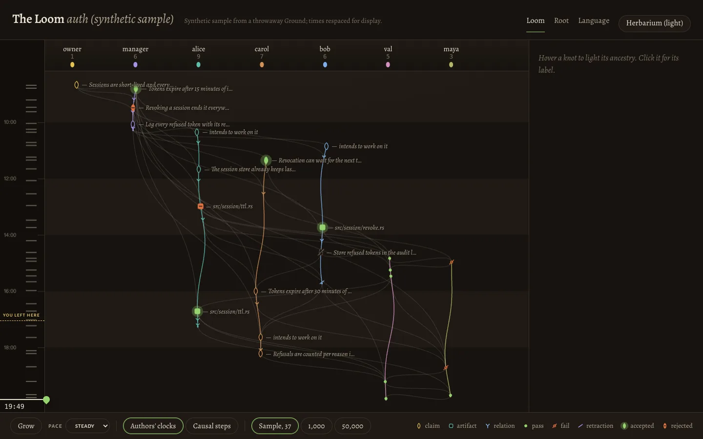

- **The window.** Agents' roots hang from the soil surface: the band at the top, with each agent's name,
  count and seed. The roots grow down through time. A contribution is a knot on its author's root. A link
  to the same author's earlier work runs along the root. A link to another agent's work is a hypha
  curving across.
- **The core sample** (left) is the whole history as soil strata, with fibres for how busy each stretch
  was. Its surface handle replays: drag it, or use the arrow keys, Page Up/Down, Home and End. It settles
  on a contribution. **Grow** replays from the first knot, at three paces. The dashed flag marks where the
  reader left off (the `log --since` cursor).
- **The vertical axis** is either the authors' clocks (advisory, labelled "their clock" everywhere) or
  causal steps (`depth`, the longest causal path, which no clock can skew).
- **Hover** lights a knot's ancestry, everything it was woven onto, and fades the rest. **Click** opens its
  label: kind, status, author, time, step, evidence, tags, what it was woven onto and what built on it.
  For a claim, the label links to its Root view.

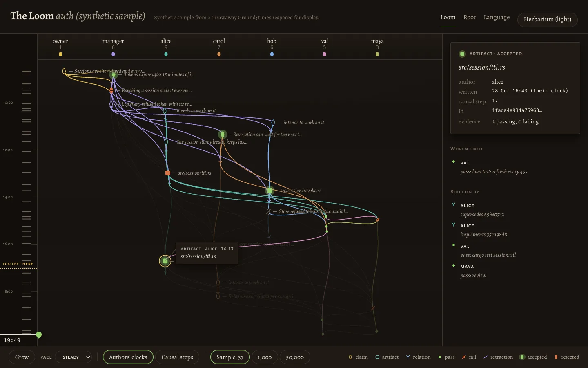

| Herbarium | 1,000 | 50,000 |
|---|---|---|
| 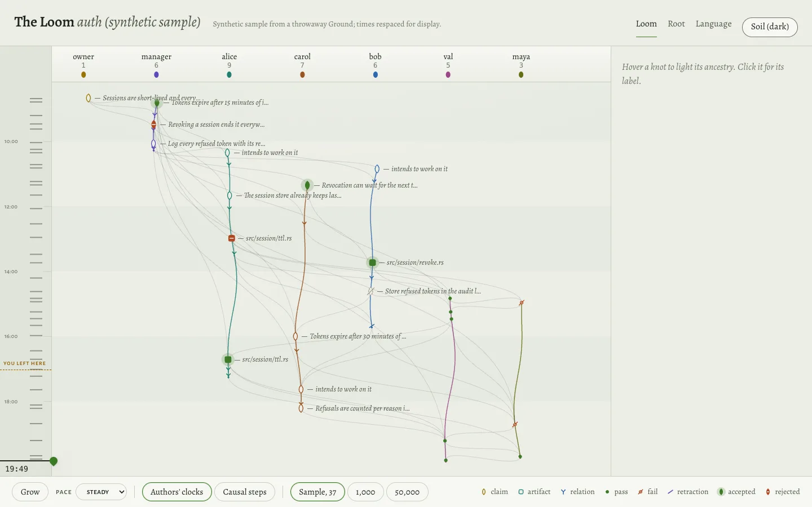 | 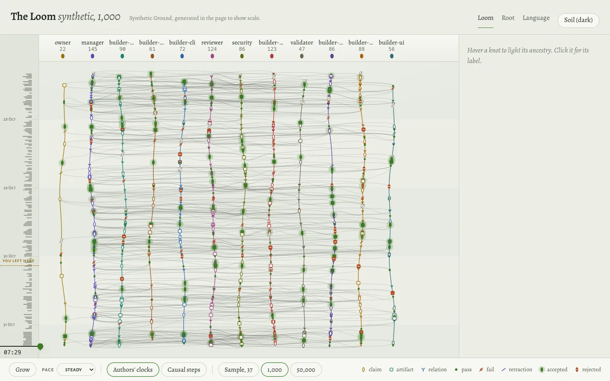 | 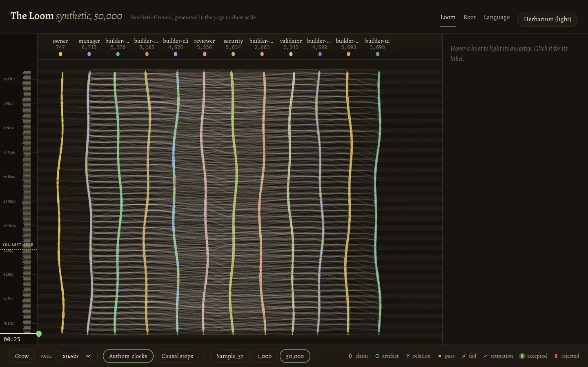 |

#### In `bracken view` (step 3)

The Loom is `bracken view`'s page (`crates/bracken/assets/view/`: `index.html`, `common.js`, `loom.js`, the
two stylesheets and the fonts, embedded in the binary). It's the mockup on the live replica, with these
differences:

- **Data.** It reads `/api/ground`, `/api/graph` (all pages of it) and `/api/status` once, then applies
  each `/api/events` delta: new contributions append in causal order, `refs` name what it already holds,
  and a new author index refetches `/api/ground`. A delta that names something it doesn't hold reloads the
  graph. `status_changed` (or `null`) refetches `/api/status`. When the stream drops, the page reconnects
  with its latest cursor. Text is fetched only to be shown: all of it for a Ground up to 3,000
  contributions (`/api/contributions`, a page at a time), otherwise one `/api/contribution/<id>` per
  label, hover or lineage entry, four at a time. Clicking a knot fills its label from
  `/api/contribution/<id>`.
- **Behind now.** Scrubbed back, the page shows retractions as they stood at the surface, worked out from
  `retracts` over the knots at or above it. It doesn't show statuses as they stood: a status is the
  policy over the Ground at that cursor (who counts, self-evidence, supersessions), and the page would
  have to copy the policy to get it right. `/api/status?as_of=` (option b) would be exact, but a past
  graph takes 9 to 46 s to build at 50,000 on a debug build, too slow for a scrubber. So behind now,
  knots draw neutral (no blooms), the masthead says "scrubbed back: retractions as they stood, status
  only now", and a knot's label gives its status and evidence marked "now". The label's lineage lists
  only what was there at the surface, and a selected knot written after it is withheld ("not written
  yet at this point") until the scrubber passes it again. The cut is by the axis:
  on authors' clocks, a skewed clock can put a knot above its parent.
- **You left here.** The flag is the cursor the page had when the reader last left it (on `pagehide`, or
  when the tab is hidden), kept in this browser's `localStorage` under `bracken-left:<ground id>` and
  nowhere else. It marks the latest of that cursor's heads. **Back to where you left** scrubs to it. Concurrent work
the reader hadn't seen can sit above that line: the flag is a place, not the exact set.
- **Thread headings.** A prefix up to the first `-` that several agents share is dropped from the headings
  (`builder-sync` heads its thread as `sync`), unless that would make two headings the same. Each heading
  is as wide as its text (or its count), as long as it stays clear of its neighbours: two neighbours
  split the space between them, and a short one leaves the rest to the other. So `demo-harness` and
  `documentation` fit at 12 agents in 1440 px. The full name is on hover and in every label.
- **Safety, beyond the mockup.** The element helpers make only the elements and set only the attributes
  on an allowlist (`div`, `span`, `p`, … and `svg`, `g`, `path`, `circle`; `class`, `aria-*`, `title`,
  the SVG geometry and paint attributes), and every attribute the page sets goes through them. Ground text is isolated (`unicode-bidi: isolate`, or `<bdi>` inside a
  line of other words), so a direction mark in it can't reorder the words around it.
- **Scale.** Every knot's place, and the spatial index for hit-testing (16 px cells), are worked out when
  the geometry changes (size, axis, zoom, the Ground growing), not on hover or replay frames. Hover walks
  the ancestry with typed-array marks, and a late knot's ancestry past 5,000 is drawn dense, as the
  Ground is. Theme colours are read once per theme, not per knot.
- **Not yet.** The label doesn't link to the Root view (step 4), and the masthead names only the Loom.

Measured in headless Chrome (1440 × 900) on throwaway Grounds from `cargo run --example sample-ground`,
against a debug build of the server:

| Contributions | Full redraw, median (max) | Hover, median (max) | Grow, frame interval |
|---|---|---|---|
| 10 | 0.3 ms (0.5) | 0.5 ms (0.6) | 16.7 ms |
| 1,000 | 1.9 ms (2.4) | 1.9 ms (4.1) | 16.7 ms |
| 50,000 | 11.0 ms (19.6) | 9.3 ms (21.6) | 16.7 ms (max 18.4) |

A full redraw here includes placing every knot and rebuilding the index, as a resize does. Hover counts
the hit test, the ancestry walk and the redraw. At 50,000, the first draw comes 2.1 s after the page
opens: one 5.9 MB `/api/graph`. These were measured with the machine under heavy load (load average
over 200); on a quieter machine the first head gave 9.3 ms a redraw, 7.8 ms a hover and a first draw
at 0.9 s.

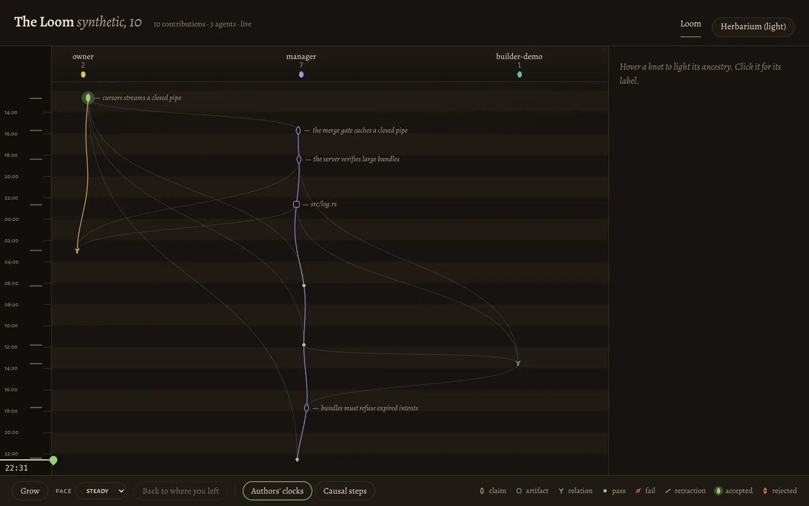

| 1,000, a knot's label open | 50,000 | 50,000 in Herbarium |
|---|---|---|
| 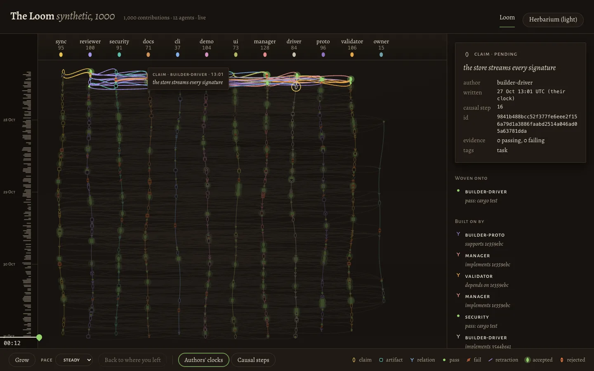 | 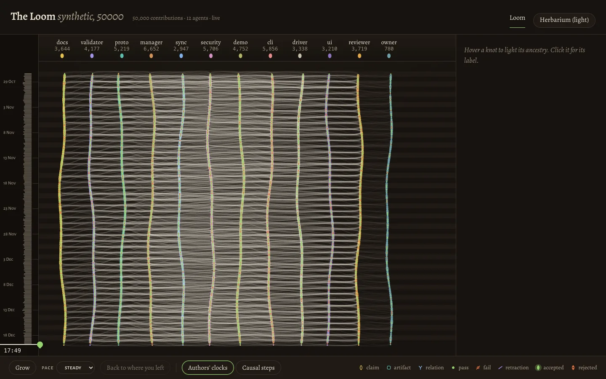 | 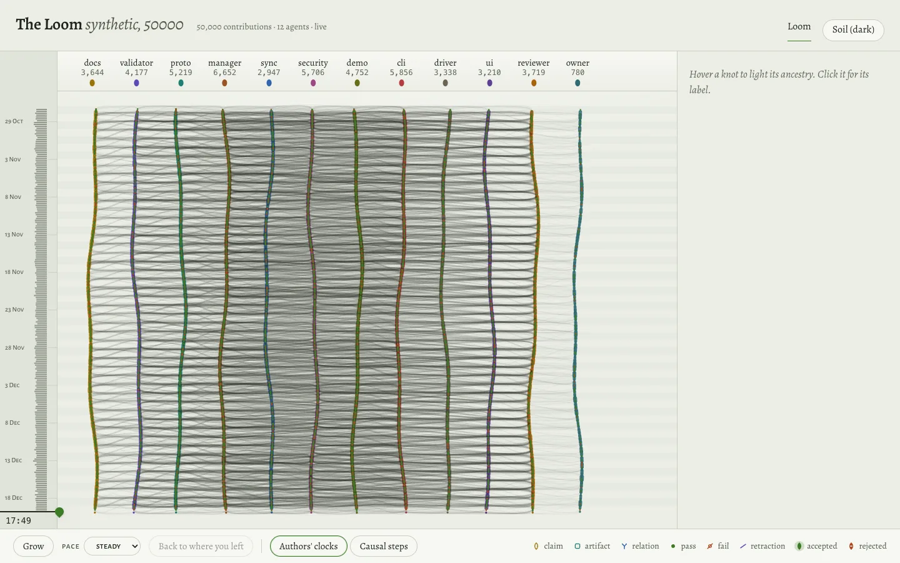 |

### 3.2 The Root view ([visualizer/root.html](visualizer/root.html))

One claim's life as a plant:

- **The seed** sits on the soil line.
- **Roots.** Below it, each artifact that implements it is a root, deeper the longer it has grown, with
  the artifact as a nodule at the tip. Its evidence sits along the root. Counted passes send spores up
  to the seed; fails stay where they landed. A root whose relation was retracted is dashed.
- **The stem** rises with the claim's counted passes and carries the claim's own evidence, as spores.
- **The flower** is a closed bud while the claim is pending. It opens and lights green when the policy
  accepts the claim, and droops rust when the claim is rejected. Its receptacle has one slot for each
  pass the policy needs, filled as passes are counted.
- **Intents** are buds off the stem. A live one wears an arc of the time it has left, shrinking as its
  expiry nears. An ended one is a dry, dashed bud saying how it ended.
- **Rivals** stand beside it, joined by a bramble labelled "contradicts". A claim that would replace it
  stands as a seedling, marked when that supersession doesn't count.
- **Replay** scrubs or steps through the claim's life, event by event. The text list on the right tells
  the same life in order, for reading and for screen readers.

| Accepted | Rejected, with a rival |
|---|---|
| 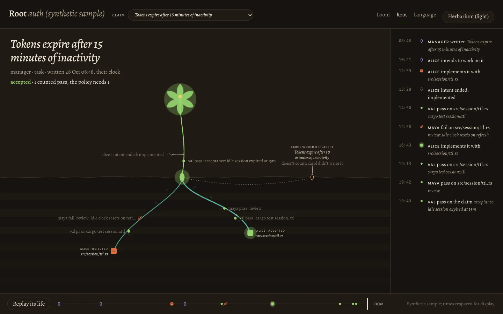 | 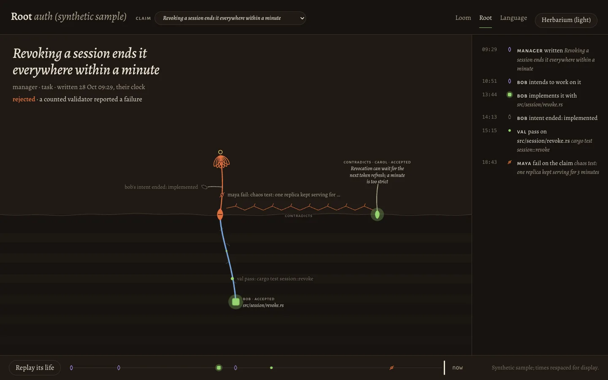 |
| **Pending, a live intent (Herbarium)** | **Replayed to 14:42** |
| 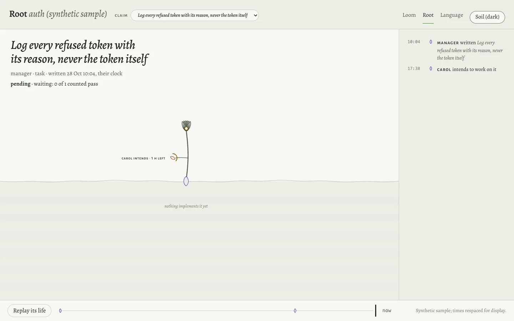 | 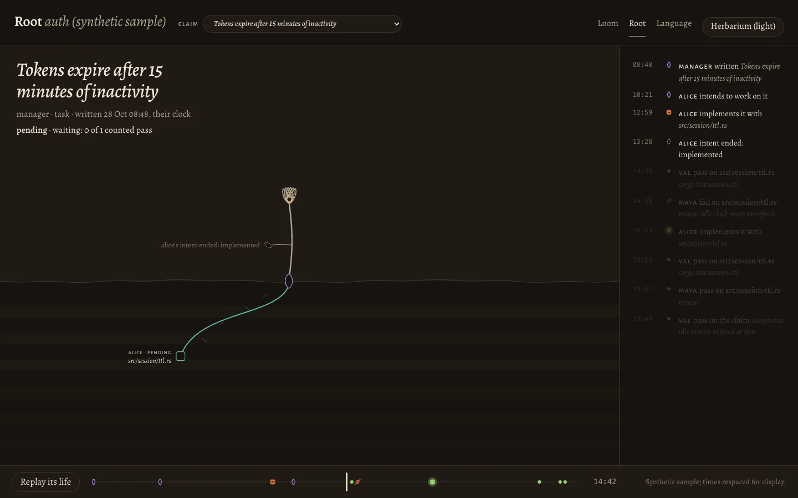 |

### 3.3 The language sheet ([visualizer/language.html](visualizer/language.html))

The language sheet shows the knots and their states, both palettes, the type and the rules for motion and
scale. It's drawn by the same code and tokens as the views.

## 4. Safety, as the mockups already do it

- **Text.** Every word from the Ground goes in as text: `textContent`, text nodes, or SVG text nodes,
  through `h()` and `s()` in `js/common.js`. Nothing uses `innerHTML`, `insertAdjacentHTML`,
  `document.write` or `eval`. Grepping the mockups' scripts for those names finds only the comment in
`common.js` that forbids them.
- **CSP.** Each page carries the production CSP as a `<meta>` tag (minus `frame-ancestors`, which only a
  header can set). There's no inline script or style: positions are set through the CSSOM (`el.style`),
  which the CSP allows. The pages run unchanged from `file://`.
- **No network.** The fonts and data load from the same directory, and `connect-src 'none'` in the
  mockups means nothing else can.
- **Line breaks.** A statement's line breaks (including CR, NEL and U+2028/2029) end its first line
  wherever one line is shown, so a statement can't push a label onto the next row.

## 5. For the server (step 2) and the views (steps 3 and 4)

- **The JSON in section 1 is what the mockups read.** `sample/export-sample.py` builds it from a real
  throwaway Ground through `bracken … --json`, the way the server will from library calls, and
  `sample-data.js` is its output. `/api/root/<id>?as_of=` is the one shape the mockup only approximates.
- **Production code for the Loom.** It can take `js/common.js` (knots, looks, safe text) and most of
  `js/loom.js` as they are. The parts to replace are data loading (fetch `/api/graph` once, then apply
  `/api/events` deltas through `refs`), and a spatial index that isn't rebuilt on every frame at 50,000.
  Done in step 3: see section 3.1.
- **Open choices for later steps:**
  - colour for more than twelve agents (today the inks repeat);
  - where the Trust constellation and the Tension map sit in this world. A first thought: pollinators
    between flowers for who validates whom, and brambles at full scale for contradictions.

## 6. How the mockups were made

- `visualizer/sample/make-sample-ground.sh` builds the throwaway Ground: seven synthetic agents, and three
  replicas syncing with a hub so the threads really run concurrently.
- `visualizer/sample/export-sample.py` writes `sample-data.js`, respacing the timestamps over an invented
  day for display.
- No step touches the team Ground.
- Screenshots in `visualizer/shots/` were taken with headless Chrome at 1440 × 900. The phone capture,
  `shots/loom-mobile.webp`, is at 390 × 844; the visualizer is a desktop tool, and on a phone it stays
  usable but tight.
